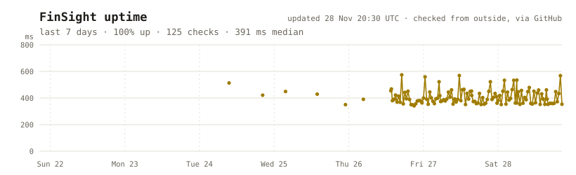

# FinSight

[](https://github.com/abdulah-x/FinSight/actions/workflows/ci.yml)

Ask which way Bitcoin, Ethereum or Gold is leaning, and get a clear answer with the evidence behind it.

Type something like "Gold 1D" or "what's the bias on Bitcoin this week?". FinSight goes and checks live prices, the US dollar and interest rates, upcoming economic news, crypto market mood and recent headlines. It then tells you whether the evidence leans **Bullish, Bearish or Neutral**, how strongly it agrees, and what would prove that view wrong.

You can watch it work step by step, and ask follow-up questions like "why?".

**FinSight gives a market view, not trade signals.** It will never tell you where to buy, sell or place a stop. Nothing here is financial advice.

## What it covers

- **Markets:** Bitcoin, Ethereum and Gold
- **Timeframes:** 1 hour, 4 hours, 1 day and 1 week

## How good is it?

FinSight grades its own past calls against what the price actually did, and we publish the result even when it isn't flattering.

**See the live results: [139.185.33.97/results](http://139.185.33.97/results).** The page updates itself every 15 minutes and shows how often FinSight was right, next to simple rules such as "follow the recent trend" and "always say Bullish", broken down by market and timeframe.

So far it's right a little under 40% of the time, **about as often as simply following the recent trend**, so it doesn't yet add anything a price chart can't tell you. Prices mostly fell in these weeks and FinSight mostly said Bearish, so a different market could look very different. Please treat FinSight as a way to see the evidence in one place, not as a prediction you can rely on.

## How it's checked

- **Every call is graded automatically.** The server saves each call, checks the price once the hour, day or week is over, and compares FinSight with simple rules such as "follow the trend" and "always say Bullish".
- **Test questions, including tricky ones.** A fixed set of questions is run against the real agent. Some are designed to trip it up: asking where to buy, stating something false, going off-topic or trying to override its instructions. A second AI model then checks that each written explanation matches the evidence.
- **It's watched around the clock.** Every 30 minutes a check from outside the server makes sure the site is answering and still saving new calls, and sends an email if not.
- **The score comes from code, not the AI.** The AI chooses what to look up and writes the explanation, but the Bullish, Bearish or Neutral call and the score are calculated by fixed rules. The same evidence always gives the same answer.



## Try it yourself

You need [Docker](https://www.docker.com/) and two free keys, from [Groq](https://console.groq.com/) and [Tavily](https://tavily.com/).

```bash
git clone https://github.com/abdulah-x/FinSight.git
cd FinSight
cp .env.example .env
# Open .env, add your two keys, and choose a database password
docker compose up --build
```

Then open http://localhost:8080.

It runs on free services, so if lots of questions arrive at once you may be asked to wait a minute.

---

Developers: the full technical details are in [CLAUDE.md](./CLAUDE.md).
